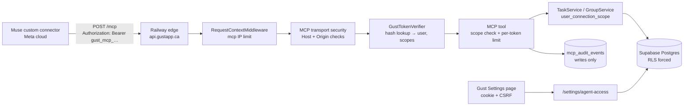
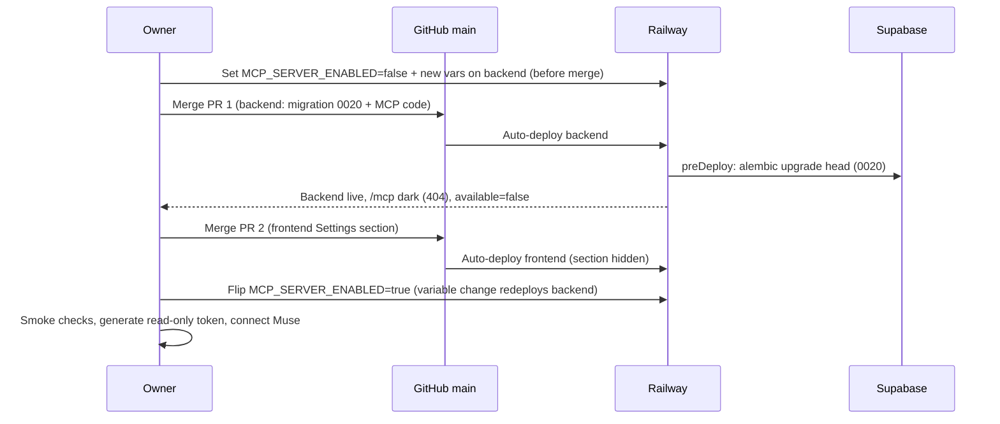

# Muse MCP Agent Access Plan

Status: built in code 2026-11-07 (all three phases), not deployed. Written 2026-11-07.

Changes from this plan made while building (see `docs/task-output/2026-11-07-muse-mcp-agent-access.md`):

- Only `/mcp` and `/.well-known/oauth-protected-resource/mcp` are routed to the SDK app, instead of `Mount("/")`. A root mount would have replaced every unknown path's JSON 404 with the SDK's plain-text one.
- The MCP Host allowlist is the `MCP_PUBLIC_URL` host (plus local hosts outside production), not every trusted host.
- `update_task` retries once with an untouched, already-passed reminder cleared, and says so, so a plain rename is not blocked by Gust's past-reminder rule.
- `mcp_audit_events` gained a `target_ids` JSON column so `create_tasks` can replay a batch.
- The `mcp` IP scope defaults to `300/60,3000/3600`.
- Tool descriptions do not repeat a per-tool Muse class beyond "Read." / "Write." / "Permanently deletes"; the MCP annotations carry the rest.

## Goal

Let Meta's Muse agent read and change one user's Gust data through an MCP server, without the user opening the app. That covers create, read, update and delete on tasks, subtasks and groups.

Each user turns this on for their own account in Settings and generates a token there. A token works for that one account only. There is no admin token and nothing that reaches across accounts.

Decisions already made by the owner (2026-11-07):

- Each user enables MCP and creates tokens in Settings. Tokens are scoped to that user.
- Agent writes go straight in. They do not land in the review queue.
- Scope: tasks, subtasks and groups, all with full CRUD.

## What Muse needs from us

Findings from 2026-11-07. Meta's own pages cover policy and approvals but not the connection mechanics, so the technical points come from third-party guides and are marked as such.

| Fact | Source | Confidence |
|---|---|---|
| Consumer Muse adds a service by **chatting**: "build a custom connector to X". Settings → Connectors lists only Meta's built-in connectors and has no URL field. | Meta Help Center | High |
| Credentials for a custom connector go in Muse's **Secure Credentials Store**. Meta does not review custom connectors. | Meta Help Center | High |
| Muse runs in **Meta's cloud**. The server must be **public HTTPS** using **Streamable HTTP**. Localhost does not work, and SSE is unreliable. | Parallel (tested), Sprites | Medium-high |
| Muse writes its own client with the official MCP SDK and saves it as a reusable skill. | Parallel (tested with their own server) | Medium |
| A static bearer token or API-key header works. | Sprites (not tested end to end), Blotato (vendor setup) | **Medium, unverified** |
| Meta classifies tools as **Read**, **Write** or **Sensitive write**. Sensitive writes ask for approval every time and can never be set to "Always allow". Tool descriptions must be factual. | Meta connector guidelines (`platform.muse.ai/docs`) | High |

What this means for Gust:

- The MCP endpoint is hosted on the public API: `https://api.gustapp.ca/mcp`. A local stdio server is not an option.
- Bearer-token auth is the riskiest assumption. Phase 1 ships read-only tools first and connects Muse to them before any write tool is built.
- Muse asks for approval on each tool call, so a batch create tool saves a lot of prompts.
- Task titles and descriptions will flow through Meta's cloud. Read-only tokens, required expiry and instant revoke are the user's controls.

## Current state

### Auth

- The API only accepts browser sessions: `gust_access_token` / `gust_refresh_token` HttpOnly cookies, resolved in [dependencies.py](../../backend/app/core/dependencies.py).
- Every unsafe method also requires a matching CSRF cookie and header plus a trusted browser `Origin` (`require_csrf`).
- Every session resolve re-checks `public.allowed_users`, so removing an email cuts access on the next request.
- Database access sets `app.current_user_id` per transaction (`user_connection_scope`). RLS is forced on user-owned tables as defense in depth, on top of explicit `user_id` filters.

### Data operations already available in services

- `TaskService`: list (status, group, search `q`, completion window, cursor), detail, create, update (full replace; needs `title` and `group_id`), complete, reopen, delete (soft delete with `occurrence` or `series` scope), restore, and subtask create, update and delete.
- `GroupService`: list with open and completed counts, create, update, delete. Deleting a group needs a destination group for its tasks, and the Inbox cannot be deleted.
- Direct create and update **reject** past reminders: "Date-and-time reminder must be in the future." The "clear and flag for review" rule applies only to AI extraction.

### Request pipeline

- `RequestContextMiddleware` applies an IP rate limit, then resolves a user from cookies for a per-user limit.
- A `POST /mcp` with no cookies would currently fall into the `unauthenticated_write` IP bucket, which is too tight for agent traffic and can't tell reads from writes. Every MCP call is a POST.
- `TrustedHostMiddleware` already accepts `api.gustapp.ca`, which shows Railway forwards the custom-domain `Host` header.
- CORS allows only the frontend origin, with `Content-Type` and `X-CSRF-Token`.

### Railway deployment

- Railway project `beee81ab-…`, environment `production`.
- Public domains: `gustapp.ca` (frontend), `api.gustapp.ca` (backend), `auth.gustapp.ca`.
- **backend** service (root `/backend`, [railway.json](../../backend/railway.json)):
  - `Dockerfile.railway` (Python 3.12, `uv sync --frozen --no-dev`).
  - `preDeployCommand` runs `alembic upgrade head` and refuses to run in production without `MIGRATION_DATABASE_URL`.
  - Starts one `uvicorn` process. Health check `/health`, restart `ALWAYS`.
- **frontend** service (root `/frontend`).
- Cron services: `digest-daily-cron`, `digest-weekly-cron`, `task-reminder-cron` (every 5 minutes), and `db-keepalive` (manual deploy only).
- **How production actually ships:** Railway's GitHub auto-deploy on `main` (the BUG-84 note records that `93ac0c2` shipped this way).
  - The GitHub Actions workflow "Railway Prod Deploy" ([railway-prod-deploy.yml](../../.github/workflows/railway-prod-deploy.yml) → [deploy-railway-prod.sh](../../scripts/prod/deploy-railway-prod.sh)) has failed since 2026-10-27, because its `RAILWAY_API_TOKEN` secret is rejected.
  - Side note: `task-reminder-cron` is also missing from that script's service list.
- **Consequence:** a merge to `main` deploys backend and frontend **at the same time**, so the runbook's backend-before-frontend order is not enforced. This plan uses separate PRs and a feature flag instead.

## Architecture

### Where the MCP server runs

**Recommended: inside the existing backend service**, mounted at `/mcp` on `api.gustapp.ca`.

- Tools call `TaskService` and `GroupService` directly, so validation, timezone rules, recurrence and user scoping are reused rather than copied.
- It needs no new Railway service, domain, DNS record, Dockerfile or deploy-script entry.
- Muse traffic for a handful of users is light, and the per-token rate limits keep it bounded.

The alternative is a separate Railway service on `mcp.gustapp.ca`, built from the same image with a different start command. It's covered in [Alternative deployment](#alternative-deployment-separate-railway-service). Only move to it if MCP traffic needs isolating from app traffic. The MCP code lives in its own module, so the split is mechanical.

### MCP server setup (SDK facts checked 2026-11-07)

- Dependency: `mcp` **2.3.x** (released 2026-10-02). The v2 API is `MCPServer` (`from mcp.server import MCPServer`), not `FastMCP`. The current spec revision is **2026-07-28**, which removes protocol-level sessions.
- Mount `mcp.streamable_http_app()` with `Mount("/", ...)` **after** all existing routers. The SDK's internal route is `/mcp`, so the endpoint is exactly `/mcp` with no trailing-slash redirect. Routes added after a root mount are unreachable, so the mount must stay last.
- Mounting disables the SDK's own lifespan. Add `async with mcp.session_manager.run():` to the existing `lifespan` in [app.py](../../backend/app/core/app.py).
- Run with `stateless_http=True` and `json_response=True`:
  - 2026-07-28 requests are sessionless anyway.
  - `stateless_http=True` also keeps older-protocol clients from pinning in-memory sessions that a redeploy would wipe. We don't know which protocol version Muse's generated client speaks.
  - `json_response=True` returns plain JSON instead of a stream, which avoids any streaming issues with the existing `BaseHTTPMiddleware`.
- Set `transport_security=TransportSecuritySettings(...)`:
  - `allowed_hosts`: exact strings from the existing trusted-host settings (`api.gustapp.ca`, `api.gustapp.ca:*`, plus `localhost:*` and `127.0.0.1:*` in dev mode). The SDK does not support wildcards, so `*.up.railway.app` is excluded.
  - `allowed_origins`: empty. Muse is not a browser, so any browser `Origin` is rejected with 403.
  - Without this setting, the SDK rejects every request to `api.gustapp.ca` with `421`.
- Auth uses the SDK's resource-server hooks: `MCPServer("gust", token_verifier=GustTokenVerifier(...), auth=AuthSettings(issuer_url=<API origin>, resource_server_url="https://api.gustapp.ca/mcp", required_scopes=["gust:read"]))`. This provides:
  - a 401 with `WWW-Authenticate: Bearer … resource_metadata="…/.well-known/oauth-protected-resource/mcp"`
  - RFC 9728 metadata at that path
  - `get_access_token()` inside tools
  - Caveat: the metadata will name Gust's API origin as the authorization server even though no OAuth endpoints exist yet. A static-bearer client like a Muse custom connector never reads it. If OAuth is added later, the document becomes accurate.
- `TokenVerifier.verify_token` is `async`, so its database lookups go through the shared `run_blocking` helper, per the backend rule against blocking the event loop.
- Tools are plain `def` functions, which the SDK runs in a worker thread. That suits the blocking SQLAlchemy services.
- Use `instructions=` and tool descriptions that are factual only, per Meta's rule 3.2. No "always call this first" steering.

## Auth design: per-user MCP tokens

### Token format and storage

- Format: `gust_mcp_` plus 43 URL-safe characters (32 random bytes from `secrets`). The fixed prefix lets GitHub secret scanning and log scrubbers recognise it.
- Only the **SHA-256 hash** is stored. That is safe for a 256-bit random secret. The plaintext is shown once, at creation, and never again.
- A display prefix (`gust_mcp_AbC1…`) is stored so users can tell tokens apart.

### Schema (migration `0020_mcp_agent_access`)

**`users`: new columns**

| Column | Type | Null | Notes |
|---|---|---|---|
| `mcp_enabled` | `boolean` | No | Default `false`. Master switch per user. |
| `mcp_enabled_at` | `timestamptz` | Yes | Last time it was turned on. |

**`mcp_access_tokens`**

| Column | Type | Null | Notes |
|---|---|---|---|
| `id` | `uuid` | No | Primary key. |
| `user_id` | `uuid` | No | FK `users.id`, cascade delete. |
| `name` | `varchar(60)` | No | User label, for example "Muse". Plain-text validated. |
| `token_prefix` | `varchar(16)` | No | Display only. |
| `token_hash` | `char(64)` | No | Hex SHA-256. **Unique.** |
| `access_level` | `varchar(16)` | No | `read` or `read_write` (check constraint). |
| `created_at` | `timestamptz` | No | Default `now()`. |
| `expires_at` | `timestamptz` | No | Required. Maximum one year from creation. |
| `last_used_at` | `timestamptz` | Yes | Updated at most once a minute per token. |
| `revoked_at` | `timestamptz` | Yes | Set on revoke or when MCP is turned off. |

Constraints: at most 5 unrevoked, unexpired tokens per user (enforced in the service). Index on `(user_id, created_at desc)`.

**`mcp_audit_events`** (Phase 2): writes only, with IDs and outcomes and no task content.

| Column | Type | Null | Notes |
|---|---|---|---|
| `id` | `uuid` | No | Primary key. |
| `user_id` | `uuid` | No | FK `users.id`, cascade delete. |
| `token_id` | `uuid` | No | FK `mcp_access_tokens.id`. |
| `tool_name` | `varchar(64)` | No | For example `create_task`. |
| `target_type` | `varchar(16)` | Yes | `task`, `subtask` or `group`. |
| `target_id` | `uuid` | Yes | ID of the affected row. |
| `outcome` | `varchar(16)` | No | `ok`, `error` or `denied`. |
| `error_code` | `varchar(64)` | Yes | Sanitized Gust error code. |
| `idempotency_key` | `varchar(64)` | Yes | From create tools. Partial unique index on `(token_id, idempotency_key)`. |
| `created_at` | `timestamptz` | No | Default `now()`. Purged after 90 days by the existing internal cleanup job. |

### RLS and the token-lookup problem

A token lookup happens **before** the user is known, so it can't run under `app.current_user_id`. The plan is to add a third database actor, alongside the existing user and internal-job actors:

- `DatabaseActor(mcp_token_lookup=True)` sets `app.mcp_token_lookup = true` for that transaction.
- `mcp_access_tokens` gets forced RLS with two policies:
  - read and write rows where `user_id = app.current_user_id` (Settings management, `last_used_at` updates)
  - **select only** when `app.mcp_token_lookup = true`
- The lookup query selects by `token_hash` only and returns `id, user_id, access_level, expires_at, revoked_at`.
- Everything after the lookup runs in `user_connection_scope` for that user.
- `mcp_audit_events` gets the normal user-owned policy.
- Grants: the runtime role gets `SELECT, INSERT, UPDATE` on `mcp_access_tokens` (no `DELETE`, since revocation is an update and user deletion cascades) and `SELECT, INSERT, DELETE` on `mcp_audit_events` (delete only for retention cleanup by the internal actor).

### Per-request verification (`GustTokenVerifier`)

Fail closed at each step. Any failure returns `None`, and the SDK sends a 401.

1. Read `Authorization: Bearer …` only. Cookies are never consulted on `/mcp`, and the cookie routes never accept bearer tokens.
2. Reject anything without the `gust_mcp_` prefix or with the wrong length before touching the database.
3. Hash, then look up under the token-lookup actor.
4. Reject if revoked or expired.
5. In `user_connection_scope`, load the session context (reusing `_load_session_context`). Reject if the email is no longer allowlisted or `users.mcp_enabled` is false.
6. Return `AccessToken(client_id=<token id>, subject=<user id>, scopes=["gust:read"] or ["gust:read", "gust:write"], …)`.
7. Update `last_used_at` if it's more than a minute old.
8. Log `mcp_auth_failed` with a reason code (`unknown`, `revoked`, `expired`, `disabled`, `not_allowlisted`). Never log the token, its hash or its prefix.

Tools call a small `require_principal(write=False|True)` helper. It reads `get_access_token()`, rebuilds the user ID, token ID and timezone, and returns a tool error ("This token is read-only") when a write tool is called with a read token. Hiding write tools from `tools/list` for read tokens is a nice extra if the SDK supports per-request tool lists. The check inside each tool is the real guard.

### Rate limits

- New IP scope `mcp` for `/mcp` in `_resolve_ip_policy`, so it no longer falls into `unauthenticated_write`. Muse calls come from shared Meta cloud IPs, so this limit is a loose flood gate, not the main control.
- New per-token scopes, enforced inside the tool wrapper because every MCP call is a `POST`:
  - `mcp_read:token`, default `120/60`
  - `mcp_write:token`, default `30/60` plus `500/86400`
- Exceeding a limit returns a tool error that tells the agent to retry later. The existing Postgres-backed `RequestRateLimiter` supplies the counters, with a small public method added for non-HTTP subjects.

## Settings: "Agent access (MCP)"

### Backend: `/settings/agent-access` (cookie session + CSRF, same pattern as `/settings/notifications`)

| Method | Path | Behaviour |
|---|---|---|
| `GET` | `/settings/agent-access` | `{available, enabled, endpoint_url, tokens: [{id, name, token_prefix, access_level, created_at, expires_at, last_used_at}]}`. `available` is false when the server-level flag is off. |
| `PUT` | `/settings/agent-access` | `{enabled}`. Turning it off **revokes every active token** for the user, so turning it back on never revives old tokens. |
| `POST` | `/settings/agent-access/tokens` | `{name, access_level, expires_in_days: 30 \| 90 \| 365}`. Requires `enabled`. Returns the plaintext token **once**. Errors when the user already has 5 active tokens. |
| `DELETE` | `/settings/agent-access/tokens/{id}` | Revokes the token. Takes effect on its next call. |
| `GET` | `/settings/agent-access/activity` | Phase 3. The last 20 audit events, joined to live task and group titles for display. |

Only a signed-in browser session can create or revoke tokens. A token can never create another token.

### Frontend ([SettingsRoute.tsx](../../frontend/src/routes/SettingsRoute.tsx))

- New section, hidden when `available` is false. It contains:
  - A toggle row, off by default. Turning it off asks "This revokes all agent tokens", then confirms.
  - A **Generate token** sheet with name (default "Muse"), access (**Read only** / **Read & write**) and expiry (30 days / **90 days** / 1 year).
  - A **one-time reveal** panel showing:
    - the token with a copy button
    - the endpoint URL
    - a copyable Muse setup message: "Build a custom connector to Gust, my task manager. Its MCP server is at https://api.gustapp.ca/mcp (Streamable HTTP). It needs a bearer token in the Authorization header. Ask me for it in a secure credential prompt, not in chat."
    - a warning that the token won't be shown again and shouldn't be pasted into chat
  - A token list with name, access, last used and expiry, and a Revoke button with a confirm dialog.
  - Phase 3: a "Recent agent activity" list.
- Follows [Design.md](../Design.md) and the existing notification-settings toggle rows. Works on mobile and desktop layouts.

## Tools

General rules:

- **Dates:** `due_date` and `reminder_date` are `YYYY-MM-DD` in the user's timezone. `reminder_at` must be ISO 8601 **with an offset**, and naive datetimes are rejected. `get_context` returns the timezone and today's date so the agent can work out "tomorrow".
- **Groups:** tools accept `group_id` **or** `group_name` (exact, case-insensitive). An unknown name is an error. Tools never create a group as a side effect.
- **Inputs:** validated with the same `input_safety` validators and length limits as the REST models. Shared models move into an MCP schema module rather than importing from route modules.
- **Outputs:** compact typed models, returned as structured content plus a JSON text block.
  - List results trim descriptions to 200 characters; `get_task` returns the full text.
  - Lists default to 25 items, with a maximum of 50 and a `next_cursor`.
- **Errors:** Gust `ApiError`s become tool errors (`isError`) with the existing sanitized message. Unexpected exceptions return a generic message with the request ID and are logged without arguments.
- **Logging:** one `mcp_tool_called` event per call, with tool name, token ID, outcome and duration. No titles, descriptions or arguments.
- **Annotations:** `ToolAnnotations` from `mcp.types` on every tool. The descriptions also name the Muse class ("Read", "Write", "Permanently deletes …"). Muse classifies custom-connector tools itself, and we don't know whether it reads MCP annotations.

### Phase 1: read tools (`gust:read`)

All use `read_only_hint=True` and `open_world_hint=False`.

| Tool | Inputs | Returns | Notes |
|---|---|---|---|
| `get_context` | none | timezone, today's local date, current time, Inbox ID, groups (ID, name, open count), overdue / due-today / needs-review counts | The agent's starting point. |
| `list_groups` | none | ID, name, description, is_system, open and completed counts | Reuses `GroupService` list. |
| `list_tasks` | `group_id`/`group_name`, `status` (`open`/`completed`), `query`, `due_start`, `due_end`, `no_due_date`, `completed_start`, `completed_end`, `limit`, `cursor` | task summaries with `due_bucket`, group, reminder and recurrence frequency, subtask count | **New:** due-date range and no-date filters in the repository (parameterized, checked against the existing pagination index). |
| `get_task` | `task_id` | full detail with subtasks and recurrence | |

### Phase 2: write tools (`gust:write`)

All use `read_only_hint=False` and `destructive_hint=False`.

| Tool | Inputs | Notes |
|---|---|---|
| `create_task` | `title`, `group_id`/`group_name` (default Inbox), `description`, `due_date`, `reminder_at` or `reminder_date`, `recurrence`, `subtasks` (up to 20 titles), `idempotency_key` | Creates the task and its subtasks **in one transaction**. `needs_review = false`, which the owner chose. |
| `create_tasks` | `tasks` (1–20 of the above), `idempotency_key` | **All or nothing:** validate every item first and create nothing if any item fails, returning per-item errors. One approval instead of twenty. |
| `update_task` | `task_id`, any of `title`, `description`, `group_id`/`group_name`, `due_date`, `reminder_at`, `reminder_date`, `recurrence`, plus `clear` (a list of `description`, `due_date`, `reminder`, `recurrence`) | **Partial update:** fetches the task, merges only the given fields, then calls the existing full update. `clear` makes "remove the due date" explicit, because MCP arguments can't reliably tell omitted from null. Keeps BUG-88 reminder shifting when the due date moves. |
| `complete_task` | `task_id` | For recurring tasks, returns the next occurrence the service creates. |
| `reopen_task` | `task_id` | |
| `restore_task` | `task_id` | Undoes a soft delete. |
| `add_subtask` | `task_id`, `title` | |
| `update_subtask` | `task_id`, `subtask_id`, `title`, `is_completed` | Partial. |
| `create_group` | `name`, `description`, `idempotency_key` | A duplicate name returns the existing conflict error. |
| `update_group` | `group_id`, `name`, `description` | Partial. The Inbox can't be renamed if the service already forbids it (verify). |

**Idempotency:** Muse may retry after a timeout, and Meta's guidelines ask connectors to prevent duplicates. Create tools take an optional `idempotency_key`. A repeat key for the same token within 24 hours returns the original result instead of creating a second copy. The audit row is written in the same transaction as the create where the service API allows it, so the unique index is the duplicate guard.

**Audit:** every write tool records one `mcp_audit_events` row, including `denied` and `error` outcomes.

### Phase 3: destructive tools (`gust:write`)

All use `destructive_hint=True`. Muse should treat them as Sensitive writes, which means approval every time.

| Tool | Inputs | Notes |
|---|---|---|
| `delete_task` | `task_id`, `scope` (`occurrence` default / `series`) | Soft delete. The description says it can be undone with `restore_task`, and the result includes the ID to restore. `series` must be passed explicitly. |
| `delete_subtask` | `task_id`, `subtask_id` | **Permanent.** |
| `delete_group` | `group_id`, `move_tasks_to_group_id`/`move_tasks_to_group_name` (**required**, no default) | **Permanent** group delete. Tasks move to the named group, and the Inbox is protected by the service. |

Hard-deleting a task is never exposed.

## Phases and acceptance criteria

### Phase 1: foundation and read tools (also the Muse test)

1. Migration `0020_mcp_agent_access`: users columns, `mcp_access_tokens`, RLS policies, lookup actor, grants.
2. `AgentAccessService` (enable/disable, create, list, revoke, resolve) and the `/settings/agent-access` routes.
3. MCP module: server construction, transport security, `GustTokenVerifier`, `require_principal`, per-token limits, read tools, due-range filter.
4. Server flag `MCP_SERVER_ENABLED`. When false, `/mcp` is not mounted (404) and `available=false`.
5. Settings UI section.
6. Tests (backend):
   - Verifier: unknown, revoked, expired, disabled and de-allowlisted tokens are rejected.
   - **User isolation:** user A's token gets "not found" for user B's task and group IDs.
   - Read token denied on a write tool (once Phase 2 lands).
   - Host 421 and Origin 403.
   - Rate limits.
   - Each read tool's happy path and not-found case.
   - Settings routes need CSRF, return the plaintext only once, enforce the 5-token cap, and revoke all tokens when MCP is turned off.
   - Tests use the HTTP transport (httpx ASGI client with a bearer header), because `get_access_token()` returns `None` with the SDK's in-memory client.
7. Tests (frontend): toggle, generate, one-time reveal, revoke, and the hidden state.
8. **Gate:** connect Muse with a read-only token in production. If Muse can't send the bearer header, stop and decide on a fallback before Phase 2 (see [Risks](#risks-and-open-questions)).

### Phase 2: write tools

Write tools, partial update, batch create, idempotency, `mcp_audit_events`, and the write rate limits. Acceptance: every tool tested for happy path, validation error, cross-user denial and read-token denial. Then test each tool from Muse on a throwaway "Muse test" group.

### Phase 3: destructive tools and activity

Delete tools, the Settings activity list, and audit retention cleanup in the existing internal job. Acceptance: delete then restore round-trips from Muse, `series` delete requires the explicit argument, and the Inbox can't be deleted.

## Railway deployment plan

### Recommended topology: no new Railway service

| Area | Change |
|---|---|
| Railway services | None added. `/mcp` is served by the existing **backend** service on `api.gustapp.ca`. |
| `backend/railway.json` | None. `preDeployCommand` already runs `alembic upgrade head`, and the start command already serves the whole app. |
| `Dockerfile.railway` | None. `uv sync --frozen` picks up `mcp` from the updated `uv.lock`. |
| Domains and DNS | None. |
| Backend variables (new) | `MCP_SERVER_ENABLED` (default `false`), `MCP_PUBLIC_URL=https://api.gustapp.ca/mcp`, `RATE_LIMIT_MCP_IP`, `RATE_LIMIT_MCP_READ_TOKEN`, `RATE_LIMIT_MCP_WRITE_TOKEN`, `MCP_AUDIT_RETENTION_DAYS=90`. Settings validation fails startup if the flag is on in production and `MCP_PUBLIC_URL` is missing or not `https`. |
| Frontend variables | None. The section is driven by `available` from the API. |
| Cron services | None. Audit purge rides on the existing internal cleanup run. |
| Deploy script | Add an optional check to `verify_live_endpoints`: when `MCP_VERIFY=true`, `POST /mcp` without a token must return `401`. This proves the endpoint is mounted and failing closed. |

### How releases ship today, and what that means here

Railway's GitHub auto-deploy builds both backend and frontend when `main` changes. Migrations run in the backend's `preDeployCommand` before the new backend starts. Because the frontend can go live at the same moment, each phase ships as **separate PRs** behind the server flag:

### Rollout steps (Phase 1)

**Before merging PR 1**

1. Confirm `MIGRATION_DATABASE_URL` is set on the backend service, and that a recoverable Supabase backup exists.
2. Run `python scripts/prod/check-postgres-rls.py --database-url "$DATABASE_URL"` and confirm the runtime role is still non-bypass.
3. Add the new backend variables in Railway with `MCP_SERVER_ENABLED=false`, so the first deploy starts dark.
4. Locally (Makefile stack): migration up from a clean database, all tests green, and the MCP Inspector (`npx @modelcontextprotocol/inspector`) connected to `http://localhost:<backend port>/mcp` with a dev token from local Settings.

**PR 1 (backend) merged → auto-deploy**

5. Railway shows the backend deploy `SUCCESS`, and preDeploy logs show `0020_mcp_agent_access` applied.
6. Verify:
   - `select version_num from alembic_version` returns `0020_mcp_agent_access`
   - the RLS check script passes and includes the new table
   - grants on the two new tables match the schema doc
   - `/health` returns 200
   - `POST /mcp` returns 404
   - `GET /settings/agent-access` returns `available=false`

**PR 2 (frontend) merged → auto-deploy**

7. The Settings page renders with no agent section.

**Turn it on**

8. Set `MCP_SERVER_ENABLED=true` in Railway. The variable change redeploys the backend.
9. Smoke checks from a terminal:
   - `POST /mcp` with no token → `401` with `WWW-Authenticate: Bearer …` and an **`https`** `resource_metadata` URL.
   - `GET /.well-known/oauth-protected-resource/mcp` → `resource` is `https://api.gustapp.ca/mcp`.
   - `POST /mcp` with `Origin: https://example.com` → `403`.
   - No `421` responses on `api.gustapp.ca`. A 421 means `allowed_hosts` is wrong.
10. In Gust Settings: turn on MCP, generate a **read-only** 30-day token, and check it with the MCP Inspector: `tools/list`, `get_context`, `list_tasks`.
11. Revoke that token and confirm the next call returns 401. Generate the token Muse will use.
12. In Muse: paste the setup message, give the token through Muse's secure prompt, then ask "what's due this week in Gust?". **This is the Phase 1 gate.**

**Phases 2 and 3** repeat steps 5–7 and 12 with their own backend and frontend PRs. The flag stays on. New tools appear when the backend deploys. Test writes with a `read_write` token on a throwaway group first.

### Monitoring

- Railway logs: `mcp_tool_called` (volume, errors), `mcp_auth_failed` by reason, and `429` responses on the `mcp*` scopes.
- `request_completed` already records `/mcp` latency with `Server-Timing`.
- The Settings "last used" column is the user-visible signal for a token in use somewhere unexpected.

### Kill switches and rollback

From fastest to broadest:

1. **One token leaked:** revoke it in Settings. Effective on its next call.
2. **One user:** turn MCP off in Settings, which revokes all that user's tokens.
3. **Everyone, emergency SQL:** `update mcp_access_tokens set revoked_at = now() where revoked_at is null;` (runtime or admin connection).
4. **Server-wide:** set `MCP_SERVER_ENABLED=false` in Railway. The backend redeploys and `/mcp` returns 404.
5. **Code rollback:** redeploy the previous backend deployment in Railway. Migration `0020` is additive (new tables plus defaulted columns), so older code runs fine against it. Do not downgrade the migration in production.

### Alternative deployment: separate Railway service

Use this only if MCP traffic should be isolated from app traffic, scaled separately, or stopped without touching the app.

- New Railway service `mcp`, built from `/backend` with the same `Dockerfile.railway`. Start command: `uvicorn app.mcp_main:app` (a small app that mounts only the MCP server).
- **No `preDeployCommand`.** Migrations stay with the backend service, and the MCP service must deploy after it.
- Variables reference the backend's (`DATABASE_URL=${{backend.DATABASE_URL}}`, and so on), as `db-keepalive` already does.
- New custom domain `mcp.gustapp.ca` (DNS CNAME), added to `allowed_hosts`, with `MCP_PUBLIC_URL` updated.
- Add the service to Railway auto-deploy (watch paths `backend/**`) and to `deploy-railway-prod.sh`'s `service_path` and default services.
- Costs: another always-on service, duplicated variables, and two deploys that must stay in lockstep with the schema.

## Risks and open questions

| Risk | Likelihood | Mitigation |
|---|---|---|
| Muse can't send a custom bearer header. | Medium | Phase 1 gate. Fallbacks, in order: (a) also accept the token in a vendor header such as `X-Gust-Token`; (b) add OAuth 2.1 (authorization code + PKCE) with Gust as the authorization server. That is a separate plan, and **never** a token in the URL. |
| `mcp` 2.3.x conflicts with FastAPI's Starlette pin in `uv.lock`. | Medium | Resolve it first, in the first commit of Phase 1. If it conflicts, upgrade FastAPI or pin a compatible `mcp` 2.x. |
| `resource_metadata` URL comes out as `http://`. | Low-medium | It's built from `MCP_PUBLIC_URL`. If it's still wrong, set the SDK option or add uvicorn `--forwarded-allow-ips` for Railway's proxy **without** changing how `X-Real-IP` identity works for rate limiting. |
| Prompt injection through task text that Muse reads. | Medium | Tool descriptions say returned text is user data. Destructive tools need approval every time in Muse. Soft delete plus restore. Required expiry and read-only tokens. |
| Duplicate creates on Muse retries. | Medium | `idempotency_key` plus the unique index. |
| Gust data in Meta's cloud. | Certain | The user opts in, read-only is available, and the Settings copy says data passes through the connected agent's provider. |
| Two deploy paths (auto-deploy and the broken Actions workflow). | Existing | Out of scope here. Fix or disable the Actions workflow separately, so a repaired token doesn't cause double deploys. |

Open decisions for the owner (recommendation first):

1. Run MCP **inside the backend service** (recommended) or as a separate Railway service.
2. Token expiry **required**, with a maximum of one year and a default of 90 days (recommended), or allow "never expires".
3. Re-enter password before generating a token: **not in v1** (recommended; cookie + CSRF is the bar today), or yes.
4. Active tokens per user: **5** (recommended).
5. Audit retention: **90 days** (recommended).
6. Rate-limit defaults: reads 120/min, writes 30/min and 500/day per token (recommended starting point).

## Docs and bookkeeping when this is built

- [database_schema.md](../database_schema.md): new columns and tables, the RLS list, the lookup-actor policy, grants.
- [backend-database-migration-runbook.md](../backend-database-migration-runbook.md): a Revision 0020 section, the flag-first rollout, the verification queries above, `/mcp` in Production Service Mapping, the kill switches.
- [Tech-Stack-Gust.md](../Tech-Stack-Gust.md): API shape (MCP and agent-access), the bearer auth path beside cookie sessions, the MCP rate-limit scopes, the MCP SDK dependency.
- [PRD-Gust.md](../PRD-Gust.md): the agent access feature, and that agent writes skip review.
- `backend/AGENTS.md`: add MCP and agent-access to the committed API surface.
- [user-access-management.md](../user-access-management.md): removing a user from the allowlist also stops their MCP tokens.
- Decision log: MCP inside the backend, per-user hashed tokens, writes skip review, soft-delete-only for tasks.
- `docs/build-plan.md`: one row per phase.

## Sources

- Meta, [How Muse works with Connectors](https://www.meta.com/help/artificial-intelligence/1687253048996149/)
- Meta, [How Muse works with your guidance and approval](https://www.meta.com/help/artificial-intelligence/1385290430137537/)
- Meta, [Muse Connector guidelines](https://platform.muse.ai/docs)
- Parallel, [Meta Muse custom integrations](https://parallel.ai/articles/meta-muse-custom-integrations)
- Sprites, [How to add an MCP server to Meta Muse](https://www.sprites.ai/muse/mcp)
- Blotato, [Meta Muse MCP](https://www.blotato.com/meta-muse)
- MCP Python SDK docs: [ASGI mounting](https://py.sdk.modelcontextprotocol.io/run/asgi/), [Deploy](https://py.sdk.modelcontextprotocol.io/run/deploy/), [Authorization](https://py.sdk.modelcontextprotocol.io/run/authorization/), [Tools](https://py.sdk.modelcontextprotocol.io/servers/tools/), [What's new in v2](https://py.sdk.modelcontextprotocol.io/whats-new/)
- MCP spec 2026-07-28: [Streamable HTTP](https://modelcontextprotocol.io/specification/2026-07-28/basic/transports/streamable-http), [Authorization](https://modelcontextprotocol.io/specification/latest/basic/authorization), [Tools](https://modelcontextprotocol.io/specification/latest/server/tools)
- [`mcp` on PyPI](https://pypi.org/project/mcp/)
